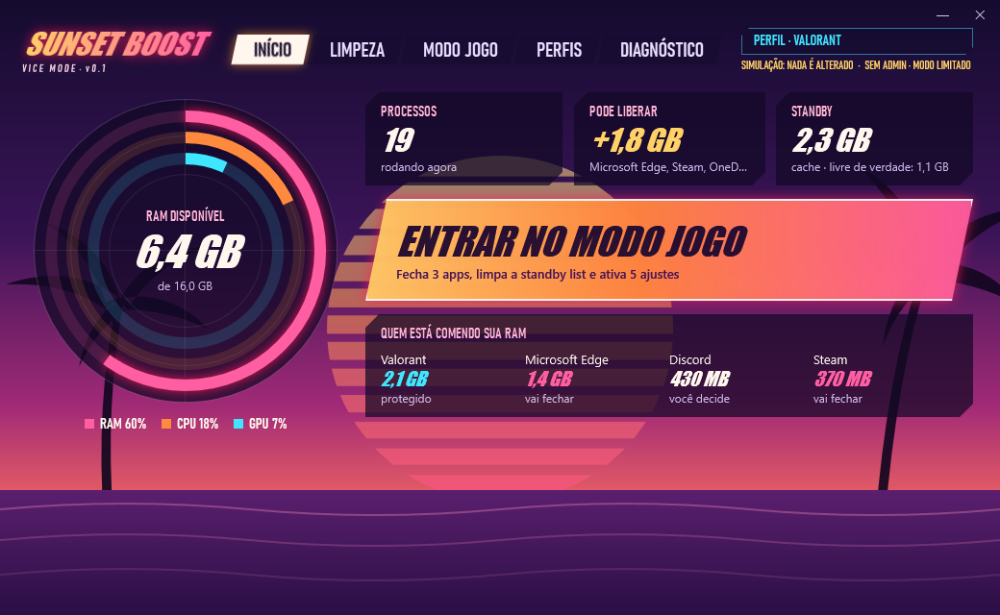
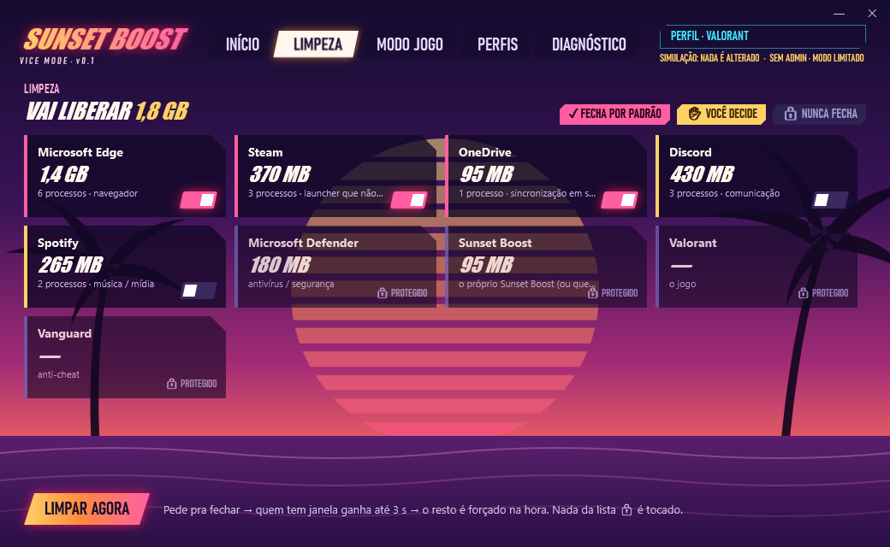
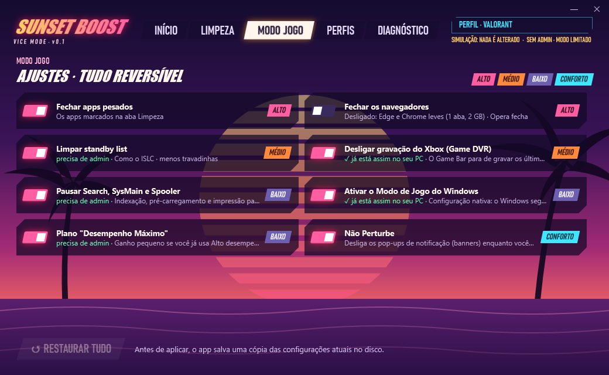
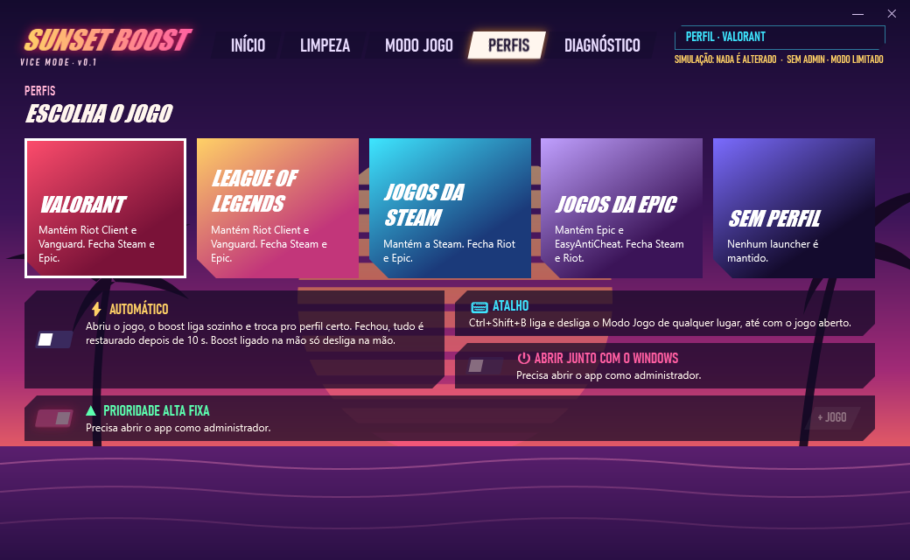
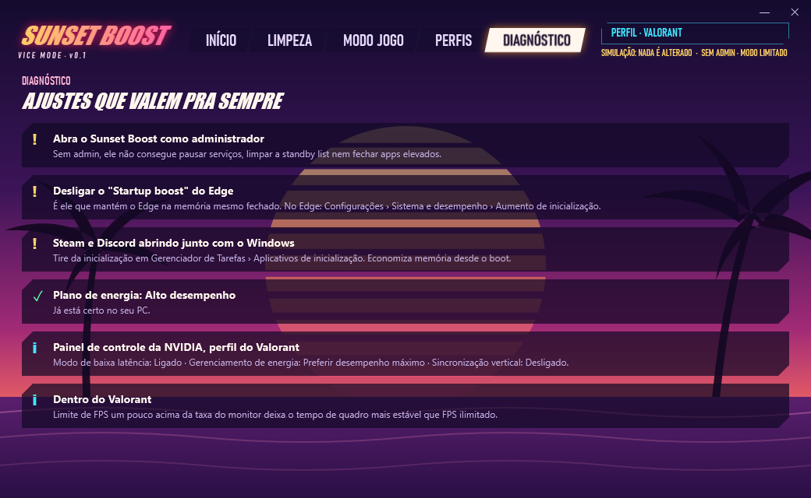

<div align="center">

# 🌴 Sunset Boost

**Modo jogo com um clique. Quando a partida acaba, tudo volta como estava.**

[](https://github.com/carlosftb/sunset-boost/releases)
[](https://github.com/carlosftb/sunset-boost/releases)
[](#-instalar)



### [⬇️ Baixar o Sunset Boost](https://github.com/carlosftb/sunset-boost/releases)

</div>

O Sunset Boost é um app pra Windows que prepara o PC pra jogar. Ele fecha o que está pesando, libera memória e aplica ajustes reversíveis no Windows. Quando você sai do jogo, ele restaura tudo.

Jogos, anti-cheats e processos do Windows nunca são tocados.

> **Versão beta.** O app funciona e tem mais de 300 testes automáticos, mas ainda falta o teste longo em partidas reais. Se algo der errado, [abra uma issue](https://github.com/carlosftb/sunset-boost/issues/new/choose).

## ✨ O que ele faz

- **Mostra quem está comendo sua RAM**: memória, CPU e GPU em tempo real, e quanto dá pra liberar.
- **Limpa antes da partida**: fecha navegadores, launchers e apps que você não está usando. Você escolhe o que fecha.
- **Modo Jogo**: limpa a memória em cache, pausa serviços pesados (indexação, SysMain, impressão), liga o plano de alto desempenho, desliga a gravação do Xbox e as notificações.
- **Desfaz tudo**: antes de mudar qualquer coisa, salva uma cópia das suas configurações. **Restaurar tudo** volta exatamente como estava.
- **Perfis por jogo**: Valorant, League of Legends, Steam, Epic. Cada perfil sabe quais launchers manter abertos.
- **Automático**: abriu o jogo, o boost liga sozinho; fechou, tudo é restaurado.
- **Atalho global**: <kbd>Ctrl</kbd>+<kbd>Shift</kbd>+<kbd>B</kbd> liga e desliga de qualquer lugar, até com o jogo aberto.
- **Diagnóstico**: dicas de ajustes que valem pra sempre, feitas pro seu PC.

<table>
  <tr>
    <td></td>
    <td></td>
  </tr>
  <tr>
    <td align="center"><b>Limpeza</b>: você vê o que fecha antes de fechar</td>
    <td align="center"><b>Modo Jogo</b>: cada ajuste com o impacto dele</td>
  </tr>
  <tr>
    <td></td>
    <td></td>
  </tr>
  <tr>
    <td align="center"><b>Perfis</b>: um por jogo, com modo automático</td>
    <td align="center"><b>Diagnóstico</b>: o que vale mudar de vez</td>
  </tr>
</table>

## 📥 Instalar

1. Baixe o `SunsetBoost-Setup-<versão>.exe` na [página de downloads](https://github.com/carlosftb/sunset-boost/releases).
2. Abra o instalador e siga os passos. Ele instala em `C:\Program Files\SunsetBoost` e cria os atalhos.
3. Abra o **Sunset Boost** pelo atalho. O Windows pede permissão de administrador: é ela que deixa o app pausar serviços e limpar a memória.

**Precisa de:** Windows 10 (versão 2004 ou mais nova) ou Windows 11, 64 bits. Não precisa instalar o .NET: ele já vem junto.

### "O Windows protegeu o computador"

O instalador ainda não tem assinatura digital (um certificado custa caro pra um projeto gratuito), então o SmartScreen avisa na primeira vez. Clique em **Mais informações** › **Executar assim mesmo**.

Pra ter certeza de que o arquivo é o mesmo que foi publicado, compare o SHA-256 dele com o da página da versão:

```powershell
Get-FileHash .\SunsetBoost-Setup-0.2.0.exe -Algorithm SHA256
```

O instalador é gerado pelo [GitHub Actions](.github/workflows/release.yml) a partir deste código, nunca num PC pessoal.

## 🎮 Como usar

1. Na aba **Perfis**, escolha o jogo.
2. Na aba **Limpeza**, confira o que vai fechar. Os apps em amarelo (**Você decide**) só fecham se você ligar.
3. Clique em **Entrar no modo jogo** (ou aperte <kbd>Ctrl</kbd>+<kbd>Shift</kbd>+<kbd>B</kbd>).
4. Depois da partida, clique de novo ou em **Restaurar tudo**.

Fechar a janela deixa o app no ícone perto do relógio. Pra sair de vez: botão direito no ícone › **Sair**.

## 🔒 É seguro?

- **Nunca fecha** processos do Windows, serviços, antivírus, anti-cheats (Vanguard, Easy Anti-Cheat, BattlEye, FACEIT…), drivers de vídeo e áudio, nem jogos. Essa lista é fixa no código e nenhuma configuração passa por cima dela.
- **Não mexe no jogo**: o app nem abre acesso aos processos de jogos e anti-cheats, nem pra medir memória. Não injeta nada, não lê memória de jogo e não muda arquivos do jogo.
- **Tudo é reversível**: cada ajuste do Modo Jogo é salvo antes e restaurado depois. Se o PC desligar no meio, o app oferece restaurar quando abrir de novo.
- **Pede pra fechar antes de forçar**: apps com janela ganham alguns segundos pra salvar e fechar sozinhos.
- **Só fala com a internet pra procurar atualização**: ao abrir, ele pergunta ao GitHub se tem versão nova. Vai só o pedido, com o seu IP e a versão do app; nada do seu PC. Dá pra desligar em **Diagnóstico** › **Procurar ao abrir**.
- **Atualização conferida**: o app só baixa e instala sozinho quando está aberto como administrador, e confere o SHA-256 do instalador no download e de novo antes de abrir. Sem admin, o botão abre a página da versão nova.
- **Código aberto pra leitura**: dá pra conferir tudo o que ele faz neste repositório.

Detalhes técnicos em [docs/DESENVOLVIMENTO.md](docs/DESENVOLVIMENTO.md#segurança). Achou uma falha de segurança? Veja o [SECURITY.md](SECURITY.md).

## 🗑️ Desinstalar

Antes, abra o app e clique em **Restaurar tudo** se o Modo Jogo estiver ativo (o desinstalador avisa se esquecer).

Depois: **Configurações do Windows** › **Aplicativos** › **Sunset Boost** › **Desinstalar**. Isso também desliga o "Abrir junto com o Windows".

As configurações e logs ficam em `C:\ProgramData\SunsetBoost`. Pode apagar essa pasta se não for instalar de novo.

## 💜 Apoie o projeto

<p align="center">
  <b>Caso queira me apoiar a continuar atualizando a ferramenta, faça uma doação.</b>
</p>

<p align="center">
  
</p>

<p align="center">Aponte a câmera do app do seu banco pro QR code, ou use um dos códigos abaixo.</p>

**Pix copia e cola:**

```text
00020126580014br.gov.bcb.pix0136f0db43bb-0fa4-4dd4-bceb-0eb4b3ba3bdd5204000053039865802BR5912Carlos Silva6009SAO PAULO62070503***6304E54A
```

**Chave Pix (aleatória):**

```text
f0db43bb-0fa4-4dd4-bceb-0eb4b3ba3bdd
```

O valor fica a seu critério: o app do banco pede na hora de pagar.

Contar pros amigos e abrir issues com bugs e ideias também ajuda muito.

## 🛠️ Para desenvolvedores

Como compilar, testar, gerar o instalador e lançar uma versão: [docs/DESENVOLVIMENTO.md](docs/DESENVOLVIMENTO.md).

## 📄 Licença

O código fica aberto pra leitura e o app é gratuito pra baixar e usar. Todos os direitos reservados: copiar, modificar ou redistribuir o código ou o app precisa de autorização. Veja [LICENSE](LICENSE).

<div align="center">
<sub>Feito no Brasil, ao pôr do sol. 🌅</sub>
</div>
